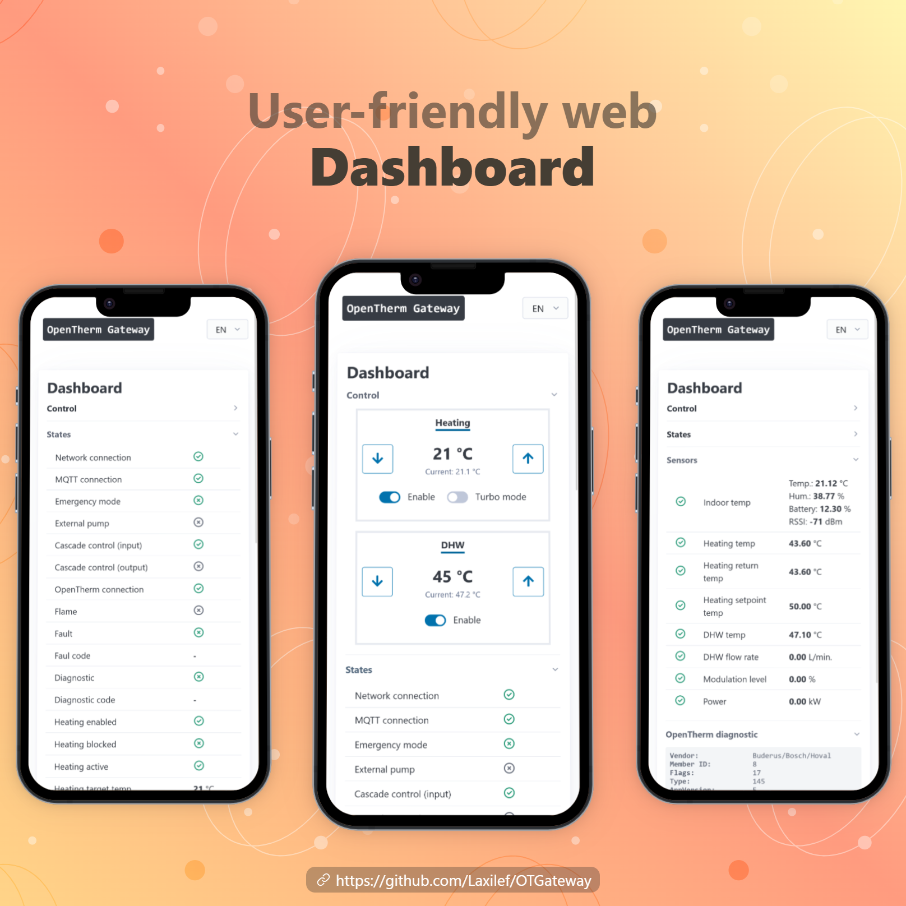
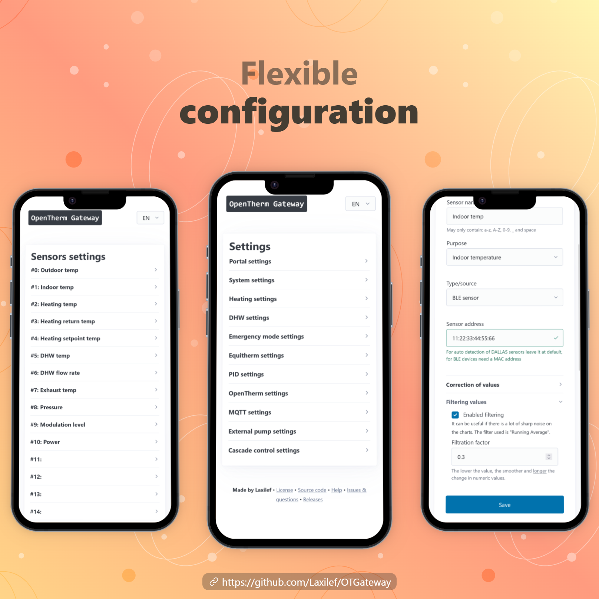
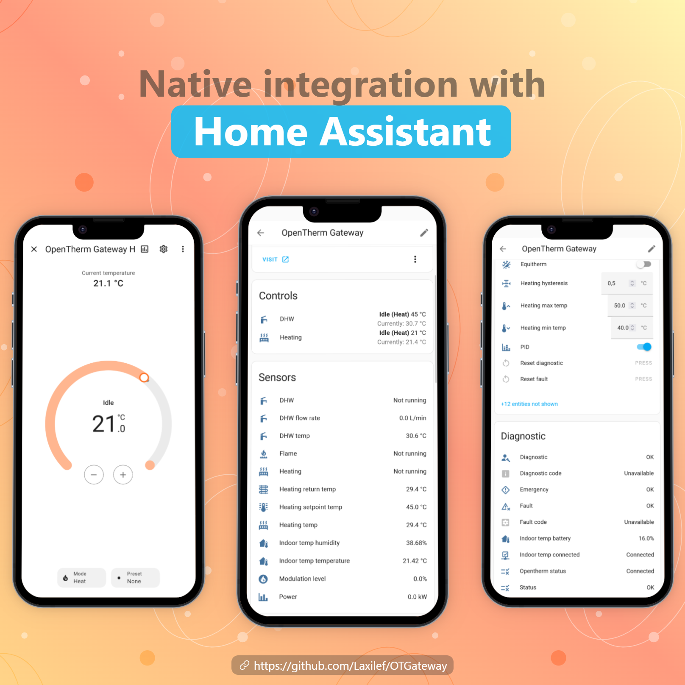

   
   
   
   
   

 
 

## Features
- DHW temperature control
- Heating temperature control
- Smart heating temperature control modes:
   - PID
   - Equithermic curves - adjusts the temperature based on indoor and outdoor temperatures
- Hysteresis setting _(for accurate maintenance of room temperature)_
- Ability to connect [additional (external) sensors](https://github.com/Laxilef/OTGateway/wiki/Sensors#temperature-sensors): Dallas (1-wire), NTC 10k, Bluetooth (BLE). Makes it possible to monitor indoor and outdoor temperatures, temperatures on pipes/heat exchangers/etc.
- Emergency mode. In any dangerous situation _(loss of connection with Wifi, MQTT, sensors, etc)_ it will not let you and your home freeze.
- Ability of remote fault reset _(not with all boilers)_
- Diagnostics:
  - Displaying gateway status
  - Displaying the connection status to the boiler via OpenTherm
  - Displaying the fault status and fault code
  - Displaying the diagnostic status & diagnostic code
  - Display of the process of heating: works/does not work
  - Display of burner (flame) status: on/off
  - Display of burner modulation level in percent
  - Display of pressure in the heating system
  - Display of current temperature of the heat carrier
  - Display of return temperature of the heat carrier
  - Display of setpoint heat carrier temperature (useful when using PID or Equitherm)
  - Display of the process of DHW: working/not working
  - Display of current DHW temperature
  - _And other information..._
- [Home Assistant](https://www.home-assistant.io/) integration via MQTT. The ability to create any automation for the boiler!

## Documentation

All available information and instructions can be found in the wiki: [English](https://github.com/Laxilef/OTGateway/wiki) · [Русский](https://github.com/Laxilef/OTGateway/wiki/Home.RU).

* Installation
   * [First installation](https://github.com/Laxilef/OTGateway/wiki/Installation-and-upgrade#first-installation)
      * [Web Flasher](https://github.com/Laxilef/OTGateway/wiki/Installation-and-upgrade#web-flasher)
      * [ESP Flash Download Tool](https://github.com/Laxilef/OTGateway/wiki/Installation-and-upgrade#esp-flash-download-tool)
   * [Build from source](https://github.com/Laxilef/OTGateway/wiki/Installation-and-upgrade#build-from-source)
   * [Update and restore](https://github.com/Laxilef/OTGateway/wiki/Installation-and-upgrade#backup-update-and-restore)
      * [Save the settings](https://github.com/Laxilef/OTGateway/wiki/Installation-and-upgrade#save-the-settings)
      * [Update firmware and filesystem](https://github.com/Laxilef/OTGateway/wiki/Installation-and-upgrade#update-firmware-and-filesystem)
      * [Restore the settings](https://github.com/Laxilef/OTGateway/wiki/Installation-and-upgrade#restore-the-settings)
* Hardware
   * [Boilers](https://github.com/Laxilef/OTGateway/wiki/Boilers)
   * [ESP32 boards](https://github.com/Laxilef/OTGateway/wiki/Boards)
   * [Temperature sensors](https://github.com/Laxilef/OTGateway/wiki/Sensors#temperature-sensors)
   * [OT adapters](https://github.com/Laxilef/OTGateway/wiki/OT-adapters)
      * [Adapters on sale](https://github.com/Laxilef/OTGateway/wiki/OT-adapters#adapters-on-sale)
      * [DIY](https://github.com/Laxilef/OTGateway/wiki/OT-adapters#diy)
         * [Files for production](https://github.com/Laxilef/OTGateway/wiki/OT-adapters#files-for-production)
         * [Connection](https://github.com/Laxilef/OTGateway/wiki/OT-adapters#connection)
         * [LEDs on board](https://github.com/Laxilef/OTGateway/wiki/OT-adapters#leds-on-board)
* Configuration
   * [Heating and OpenTherm](https://github.com/Laxilef/OTGateway/wiki/Heating-and-OpenTherm)
      * [Heating hysteresis](https://github.com/Laxilef/OTGateway/wiki/Heating-and-OpenTherm#heating-hysteresis)
      * [Equitherm](https://github.com/Laxilef/OTGateway/wiki/Heating-and-OpenTherm#equitherm)
         * [Curve parameters](https://github.com/Laxilef/OTGateway/wiki/Heating-and-OpenTherm#curve-parameters)
         * [Tune the curve](https://github.com/Laxilef/OTGateway/wiki/Heating-and-OpenTherm#tune-the-curve)
      * [PID](https://github.com/Laxilef/OTGateway/wiki/Heating-and-OpenTherm#pid)
         * [Tune PID using indoor temperature](https://github.com/Laxilef/OTGateway/wiki/Heating-and-OpenTherm#tune-pid-using-indoor-temperature)
      * [Using Equitherm with PID](https://github.com/Laxilef/OTGateway/wiki/Heating-and-OpenTherm#using-equitherm-with-pid)
      * [Protections and emergency mode](https://github.com/Laxilef/OTGateway/wiki/Heating-and-OpenTherm#protections-and-emergency-mode)
         * [Overheat protection](https://github.com/Laxilef/OTGateway/wiki/Heating-and-OpenTherm#overheat-protection)
         * [Freeze protection](https://github.com/Laxilef/OTGateway/wiki/Heating-and-OpenTherm#freeze-protection)
         * [Emergency mode](https://github.com/Laxilef/OTGateway/wiki/Heating-and-OpenTherm#emergency-mode)
   * [Sensor setup](https://github.com/Laxilef/OTGateway/wiki/Sensors#connect-a-temperature-sensor)
      * [Choose a purpose](https://github.com/Laxilef/OTGateway/wiki/Sensors#choose-a-purpose)
      * [Supply a reading from another system](https://github.com/Laxilef/OTGateway/wiki/Sensors#supply-a-reading-from-another-system)
* Integrations
   * [MQTT](https://github.com/Laxilef/OTGateway/wiki/MQTT)
      * [Topic structure and access](https://github.com/Laxilef/OTGateway/wiki/MQTT#topic-structure-and-access)
      * [State topics](https://github.com/Laxilef/OTGateway/wiki/MQTT#state-topics)
      * [Settings](https://github.com/Laxilef/OTGateway/wiki/MQTT#settings)
      * [Sensor topics](https://github.com/Laxilef/OTGateway/wiki/MQTT#sensor-topics)
      * [Examples](https://github.com/Laxilef/OTGateway/wiki/MQTT#examples)
   * [REST API](https://github.com/Laxilef/OTGateway/wiki/REST)
      * [Endpoints](https://github.com/Laxilef/OTGateway/wiki/REST#endpoints)
      * [Settings](https://github.com/Laxilef/OTGateway/wiki/REST#settings)
      * [Network](https://github.com/Laxilef/OTGateway/wiki/REST#network)
      * [Sensors](https://github.com/Laxilef/OTGateway/wiki/REST#sensors)
      * [Examples](https://github.com/Laxilef/OTGateway/wiki/REST#examples)
   * [Home Assistant](https://github.com/Laxilef/OTGateway/wiki/Home-Assistant)
      * [Connection](https://github.com/Laxilef/OTGateway/wiki/Home-Assistant#connection)
      * [Report a temperature sensor](https://github.com/Laxilef/OTGateway/wiki/Home-Assistant#report-a-temperature-sensor)
      * [Report outdoor weather temperature](https://github.com/Laxilef/OTGateway/wiki/Home-Assistant#report-outdoor-weather-temperature)
      * [DHW meter](https://github.com/Laxilef/OTGateway/wiki/Home-Assistant#dhw-meter)
   * [HOMEd](https://github.com/Laxilef/OTGateway/wiki/HOMEd)
      * [Connect](https://github.com/Laxilef/OTGateway/wiki/HOMEd#connect)
      * [Heating and DHW control](https://github.com/Laxilef/OTGateway/wiki/HOMEd#heating-and-dhw-control)
      * [Sensors](https://github.com/Laxilef/OTGateway/wiki/HOMEd#sensors)
         * [Supply a temperature to OTGateway](https://github.com/Laxilef/OTGateway/wiki/HOMEd#supply-a-temperature-from-homed-to-otgateway)
      * [Diagnostics](https://github.com/Laxilef/OTGateway/wiki/HOMEd#diagnostics)
      * [Migrate an existing integration](https://github.com/Laxilef/OTGateway/wiki/HOMEd#migrate-an-existing-integration)
* Other
   * [FAQ and troubleshooting](https://github.com/Laxilef/OTGateway/wiki/FAQ-%26-Troubleshooting)
      * [Installation and connection](https://github.com/Laxilef/OTGateway/wiki/FAQ-%26-Troubleshooting#installation-and-connection)
      * [Heating and hot water](https://github.com/Laxilef/OTGateway/wiki/FAQ-%26-Troubleshooting#heating-and-hot-water)
      * [Sensors](https://github.com/Laxilef/OTGateway/wiki/FAQ-%26-Troubleshooting#sensors)
      * [MQTT and Home Assistant](https://github.com/Laxilef/OTGateway/wiki/FAQ-%26-Troubleshooting#mqtt-and-home-assistant)
      * [Logs and debug](https://github.com/Laxilef/OTGateway/wiki/FAQ-%26-Troubleshooting#logs-and-debug)
   * [Core dump analysis](https://github.com/Laxilef/OTGateway/wiki/Core-dump-analysis)
      * [Windows (PowerShell)](https://github.com/Laxilef/OTGateway/wiki/Core-dump-analysis#windows-powershell)
      * [Linux (shell)](https://github.com/Laxilef/OTGateway/wiki/Core-dump-analysis#linux-shell)
      * [What the report contains](https://github.com/Laxilef/OTGateway/wiki/Core-dump-analysis#what-the-report-contains)
      * [Finding the likely cause](https://github.com/Laxilef/OTGateway/wiki/Core-dump-analysis#finding-the-likely-cause)

## Translations
The project uses [Weblate](https://hosted.weblate.org/new-lang/otgateway/) to manage translations of the interface. 
Anyone is welcome to add their native language as a [new localization](https://hosted.weblate.org/new-lang/otgateway/portal/). All contributions are welcome!

## Gratitude
* To the developers of the libraries used: [ArduinoJson](https://github.com/bblanchon/ArduinoJson), [NimBLE-Arduino](https://github.com/h2zero/NimBLE-Arduino), [MycilaMQTT](https://github.com/mathieucarbou/MycilaMQTT), [MycilaHADiscovery](https://github.com/mathieucarbou/MycilaHADiscovery), [AsyncTCP](https://github.com/ESP32Async/AsyncTCP), [ESPAsyncWebServer](https://github.com/ESP32Async/ESPAsyncWebServer), [MycilaWebSerial](https://github.com/mathieucarbou/MycilaWebSerial), [MycilaTaskManager](https://github.com/mathieucarbou/MycilaTaskManager), [FileData](https://github.com/GyverLibs/FileData), [GyverPID](https://github.com/GyverLibs/GyverPID), [GyverBlinker](https://github.com/GyverLibs/GyverBlinker), [OneWireNg](https://github.com/pstolarz/OneWireNg), [DallasTemperature](https://github.com/milesburton/Arduino-Temperature-Control-Library) & [esp32DHT](https://github.com/bertmelis/esp32DHT)
* To the [PlatformIO](https://platformio.org/) Team
* To the team and contributors of the [pioarduino](https://github.com/pioarduino/platform-espressif32) project
* To the [BrowserStack](https://www.browserstack.com/) team. This project is tested with BrowserStack.
* To the [PVS-Studio](https://pvs-studio.com/pvs-studio/?utm_source=website&utm_medium=github&utm_campaign=open_source) - static analyzer for C, C++, C#, and Java code.
* And of course to the contributors for their contribution to the development of the project!
